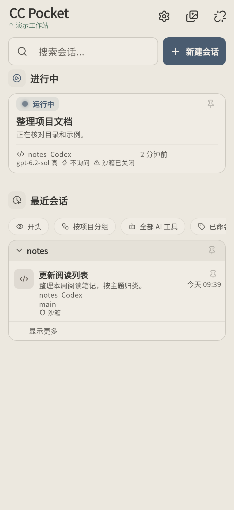
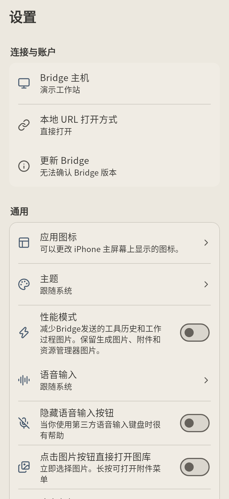

# CC Pocket

**把编程代理，装进口袋。**

用手机聊天的方式操作 Codex 和 Claude：发出指令、批准下一步、查看结果。
换到平板或 Mac，也能继续同一项工作。

**[下载 iPhone / iPad 安装包（1.140.10，构建 273）](https://github.com/zwthys-cyber/ccpocket/releases/download/trollstore/v1.140.10%2B273/CC-Pocket-TrollStore-unsigned.ipa)** · [版本说明与 SHA-256](https://github.com/zwthys-cyber/ccpocket/releases/tag/trollstore/v1.140.10%2B273) · [安装指南](https://zwthys-cyber.github.io/ccpocket/install/?lang=zh)

[English README](README.en.md) | [日本語 README](README.ja.md) | [한국어 README](README.ko.md)

<p align="center">
  
  
</p>

## 安装

此分支由 `zwthys-cyber` 独立维护，应用标识为 `com.zwthys.ccpocket`。iOS 版本是
无需 Apple Developer 账号的 TrollStore 未签名 IPA；目前没有 App Store、Google Play
或官方推送服务。

### 当前服务器版 Bridge 1.122.0

2026-11-27 已部署维护补丁 [`fa20a82`](https://github.com/zwthys-cyber/ccpocket/tree/fa20a82c9f9203305e1220fd9fec39f1c7827de4)。配合手机端 1.140.9（272），修复 Codex 重连后重复显示气泡、插话时间错误和图库并发删除失败。手机界面自动跟随系统语言，DeepSeek Flash 与 `deepseek-v4-pro` 继续可用。

- 新装 Linux x64 服务器可[下载完整运行包](https://github.com/zwthys-cyber/ccpocket/releases/download/bridge-maintained/v1.122.0-fa20a82/deepseek-server-runtime.zip)。包内包含生产依赖。已有服务器的升级条件见 [Bridge 发布说明](https://github.com/zwthys-cyber/ccpocket/releases/tag/bridge-maintained/v1.122.0-fa20a82)。
- [线上版本、构建记录与校验方法](docs/bridge-server-status.zh-CN.md)
- [DeepSeek 配置与模型选择](docs/deepseek.zh-CN.md)

### 新服务器安装：先看这份中文教程

**第一次安装，直接按 [新服务器从零安装 CC Pocket](docs/server-setup.zh-CN.md) 操作。**
教程面向 Ubuntu 24.04 x86_64 云服务器，从 SSH 登录开始，一步步完成：

1. 安装 Node.js 和 Codex，并完成账号登录。
2. 在 GitHub 获取已验证的 Linux x64 完整运行包。
3. 服务器只下载已验证的运行包，生成手机连接密钥。
4. 配置后台运行和开机自启，处理网络连接。
5. 手机添加服务器、选择项目并发送第一条任务。
6. 后续更新、回退和常见问题排查。

运行包在 GitHub 构建和测试。服务器安装 Node.js **22.19.0 或更高版本**后，按教程校验并解压[已发布的运行包](https://github.com/zwthys-cyber/ccpocket/releases/tag/bridge-maintained/v1.122.0-fa20a82)即可。

服务器 IP 要填写你新机器的地址；API Key 是教程自动生成的 Bridge 连接密钥，
与 GitHub Token、OpenAI API Key、DeepSeek API Key 不同。

### 手机安装包

| 平台 | 安装 |
|------|------|
| **iOS / iPadOS（TrollStore）** | 在支持 TrollStore 的设备上打开[1.140.10（273）未签名 IPA](https://github.com/zwthys-cyber/ccpocket/releases/download/trollstore/v1.140.10%2B273/CC-Pocket-TrollStore-unsigned.ipa)，用 TrollStore 安装。可下载 [SHA-256 校验文件](https://github.com/zwthys-cyber/ccpocket/releases/download/trollstore/v1.140.10%2B273/CC-Pocket-TrollStore-unsigned.ipa.sha256)。 |
| **Android / macOS / Linux / Windows** | 此分支暂未提供经过验证的公开安装包，可按开发说明自行构建。 |

## 免费使用

CC Pocket 可以免费使用。如果它对你的开发流程有帮助，欢迎在应用内成为 Supporter。Supporter 购买会用于覆盖 AI 工具费用，并帮助持续开发。

## 可以做什么

- **像聊天一样操作。** 每个会话就是一个房间，集中显示指令、回复、审批和问题。支持 Markdown、语音输入和图片附件。
- **换个设备，继续工作。** 在手机、平板或 Mac 上恢复 CLI 或应用中的会话。大屏幕可并排显示聊天、文件和 Git 差异。
- **断网也不丢输入。** 离线消息会暂存，重连后自动发送，并恢复遗漏的回复。执行新请求仍需要网络连接。
- **生成、查看、播放。** 用 Codex Imagegen 生成图片，在聊天中查看结果。视频和音频文件也能直接在应用内播放。
- **从审查到提交。** 浏览文件，查看代码和图片差异，执行 stage、commit、push 或 revert。通过 git worktree 分离并行任务。
- **使用自己的主机。** 代理通过 Mac、Linux 或 Windows 上的 Bridge Server 运行。用二维码、已保存主机或 Tailscale 连接，也可通过 SSH 管理 Bridge。

## 工作方式

CC Pocket 由两部分组成：

```text
CC Pocket app  <->  你自己机器上的 Bridge Server  <->  Codex / Claude
```

App 是操作界面。Bridge Server 在能够访问你的项目、shell、git 仓库和代理 CLI
的主机上运行。你的代码留在自己的机器上，不需要迁移到托管 IDE。

## 远程访问

在同一网络内，你可以使用二维码、mDNS 自动发现，或手动输入
`ws://` / `wss://` URL 连接。

如果要从家或办公室之外访问，推荐使用 Tailscale：

1. 在主机和手机上安装 [Tailscale](https://tailscale.com/)
2. 加入同一个 tailnet
3. 从 CC Pocket 连接 `ws://<host-tailscale-ip>:8765`

云服务器的后台运行、开机自启、公网端口和连接密钥配置，请按
[新服务器安装教程](docs/server-setup.zh-CN.md#6-设置后台服务和开机自启)操作。
教程直接运行本仓库的 GitHub 构建产物，不会切换到 npm 发布版。

服务化设置支持 macOS launchd 和 Linux systemd。
关于 `BRIDGE_ALLOWED_DIRS` 等 Bridge 设置，请见
[Bridge package README](packages/bridge/README.md#configuration)。

## 说明

- 推送通知默认关闭。本分支不使用原作者的 Firebase/APNs。若以后拥有自己的推送基础设施，需同时配置
  `BRIDGE_FIREBASE_API_KEY` 和 `BRIDGE_PUSH_RELAY_URL`，并在 iOS 工程中配置自己的 Firebase/APNs。
- 应用内购买默认关闭；只有显式提供自己的 `REVENUECAT_PUBLIC_KEY` 才会启用 RevenueCat。
- 本分支不使用原作者的 Shorebird 配置。

- Claude 会话默认使用 `ANTHROPIC_API_KEY`。由于官方文档对此架构的适用范围尚不明确，
  订阅认证需要在 Bridge 上通过 `BRIDGE_ALLOW_CLAUDE_OAUTH=1` 明确启用。
  详情请见 [Claude 认证排查](docs/auth-troubleshooting.zh-CN.md)。
- CC Pocket 围绕自托管和最少数据收集设计。Supporter 购买可以在同一个
  Apple ID / Google 账号内恢复，但不会在不同商店之间同步。
  详情请见 [Supporter / Purchases](docs/supporter_zh.md)。
- macOS 截图功能需要为运行 Bridge Server 的终端应用授予屏幕录制权限。
- CC Pocket 与 Anthropic 或 OpenAI 没有任何关联，也未获得其认可、赞助或官方合作。

## 开发

```bash
git clone https://github.com/zwthys-cyber/ccpocket.git
cd ccpocket
npm install
cd apps/mobile && flutter pub get && cd ../..
```

常用命令：

| 命令 | 说明 |
|------|------|
| `npm run bridge` | 以开发模式启动 Bridge Server |
| `npm run bridge:build` | 构建 Bridge Server |
| `npm run dev` | 重启 Bridge 并启动 Flutter App |
| `npm run test:bridge` | 运行 Bridge Server 测试 |
| `cd apps/mobile && flutter test` | 运行 Flutter 测试 |
| `cd apps/mobile && dart analyze` | 运行 Dart 静态分析 |

贡献指南请见 [CONTRIBUTING.md](CONTRIBUTING.md)。

## 许可证

[MIT](LICENSE)
